# Property Tax Management (demo)

Portfolio demo of a municipal property tax system modernized from a legacy Oracle Forms/PL/SQL style
into Spring Boot + React on AWS. **All data and tax rates are fictional.** Not affiliated with any municipality.
Payments are simulated records only; no money moves.

## Screenshots
Taken from the AWS deployment, signed in with the password-less demo accounts. Email addresses of real
(non-demo) accounts are blurred.

**Sign in:** Cognito sign-in, plus one-click demo accounts for each role
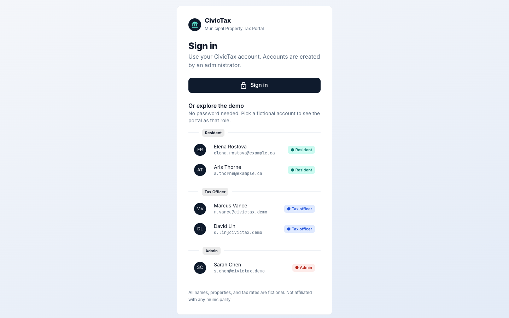

### Administrator
| System overview | User management | Reports (Step Functions, DynamoDB, S3) |
|---|---|---|
| 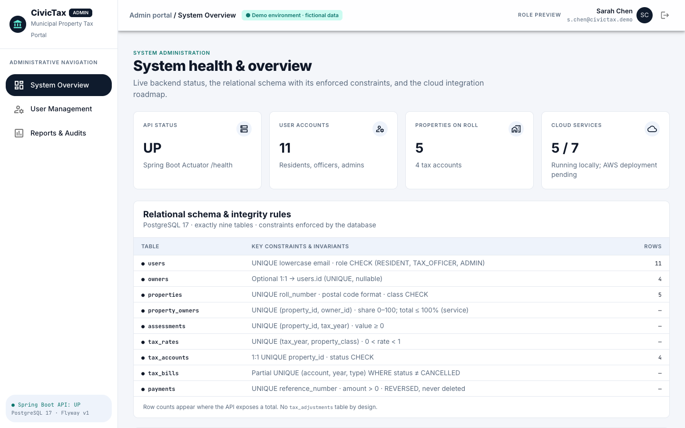 | 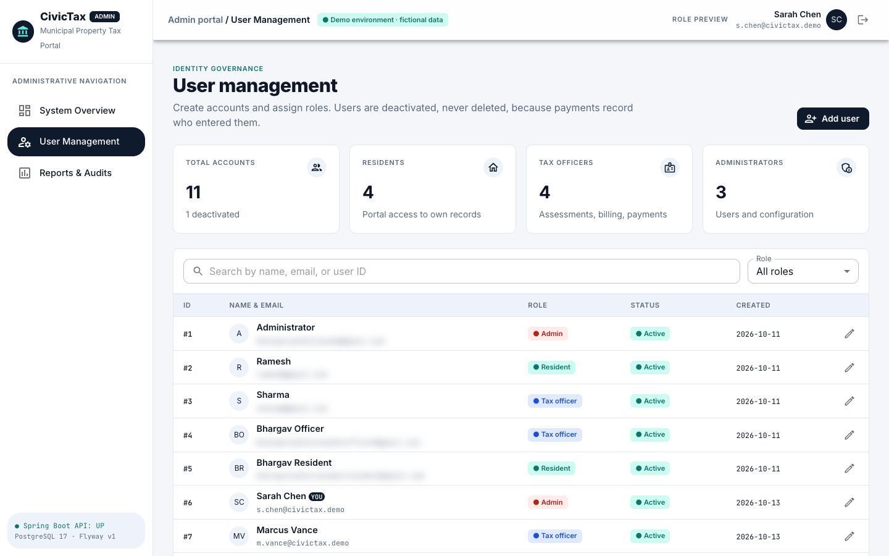 | 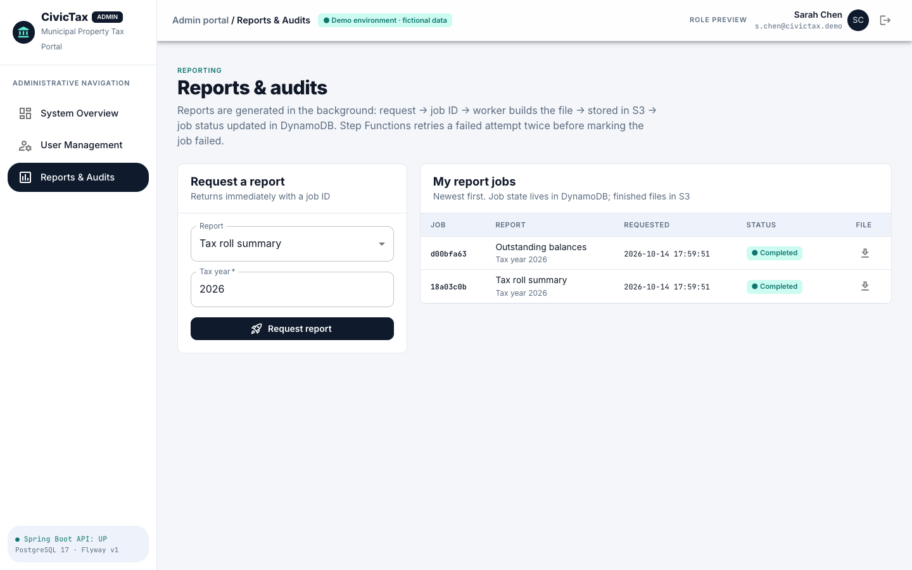 |

### Tax officer
| Overview | Properties | Owners |
|---|---|---|
| 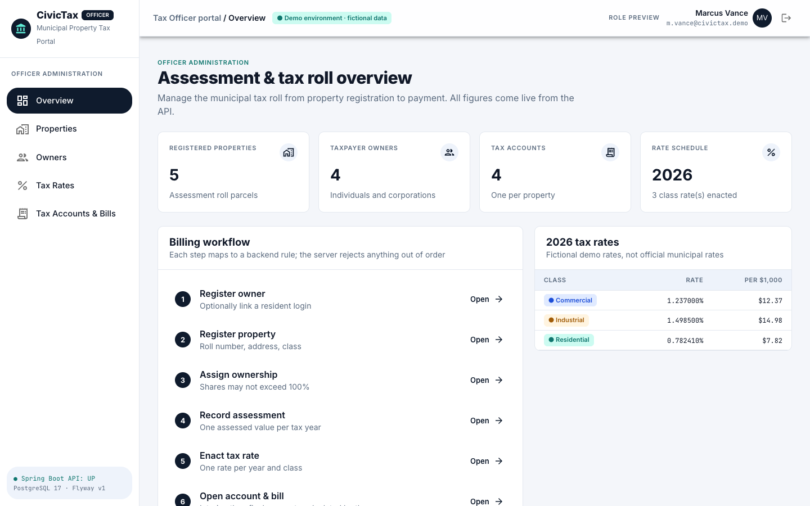 | 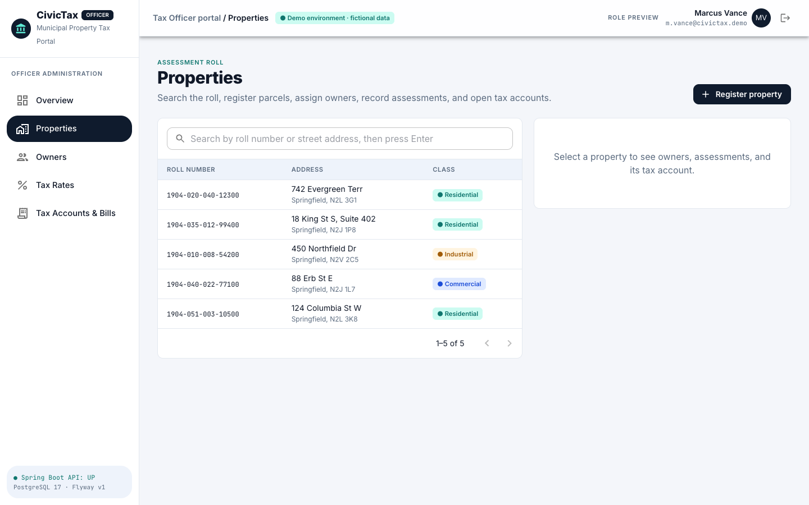 | 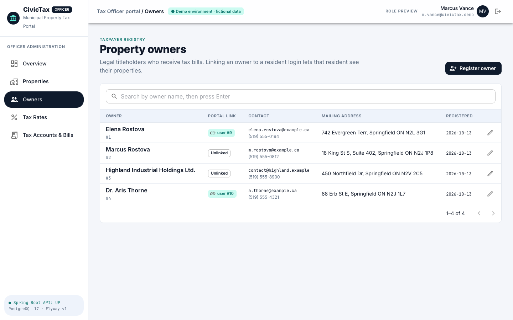 |

| Tax rates | Tax accounts | Account bills and payments |
|---|---|---|
| 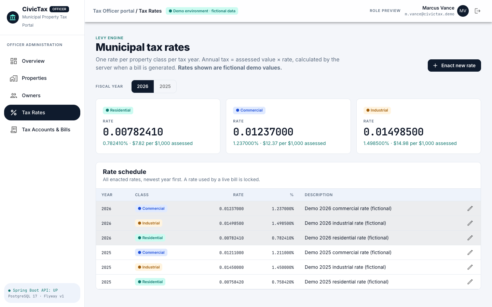 | 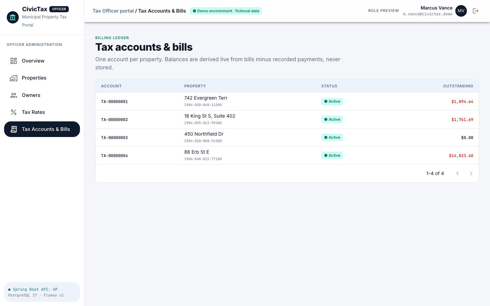 | 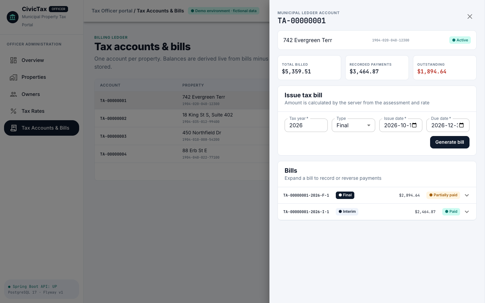 |

### Resident
| My properties | Payments |
|---|---|
| 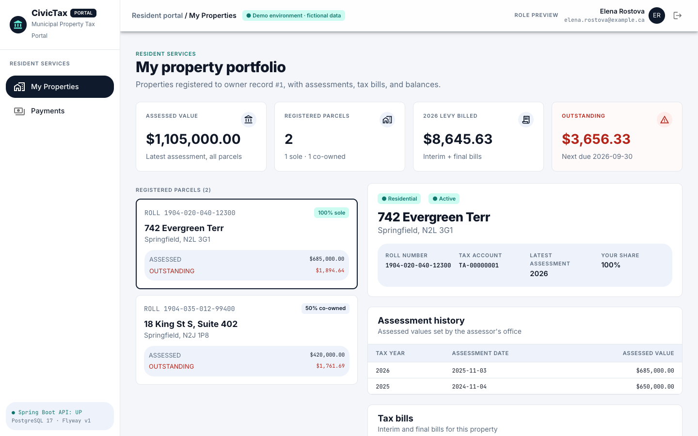 | 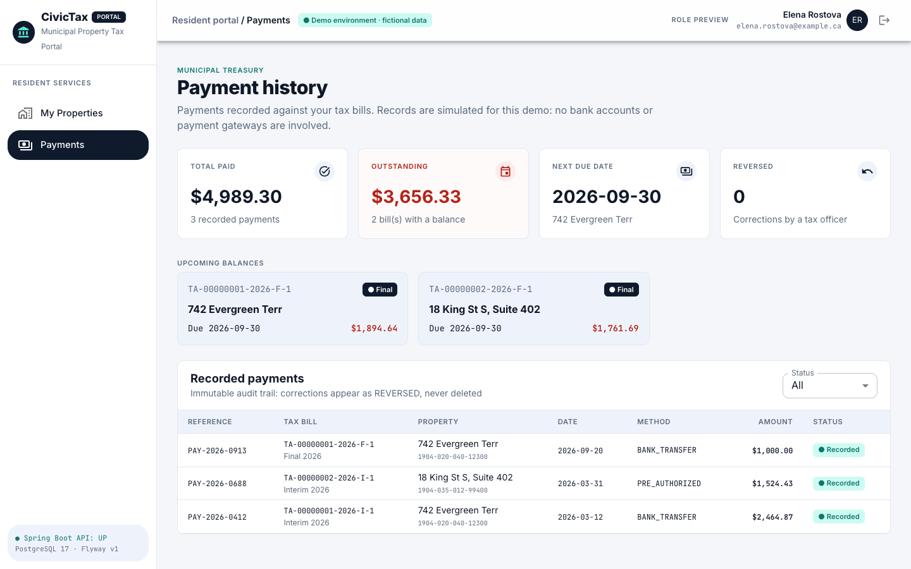 |

## Prerequisites
Java 21+ and Docker (running). Maven is not needed — use the wrapper `./mvnw`.

## Run everything with Docker (one command)
```bash
cp .env.example .env              # then set DB_PASSWORD
docker compose up -d --build --wait      # PostgreSQL + AWS emulators + backend + frontend → http://localhost:8088
API=http://localhost:8088 scripts/seed-demo-data.sh   # first run only: fictional demo data
```
The web container (nginx) serves the React build and proxies `/api` to the backend, which is not published to the
host. Logs: `docker compose logs -f backend`. Stop: `docker compose stop`. Delete everything incl. data:
`docker compose down -v`. Rebuild after code changes: `docker compose up -d --build --wait`.

## Run the backend (development)
```bash
cp .env.example .env              # then set DB_PASSWORD (DEV_AUTH=true enables local sign-in)
docker compose up -d --wait postgres s3 dynamodb stepfunctions   # database + AWS emulators (S3, DynamoDB, Step Functions)
cd backend && ./mvnw spring-boot:run   # reads ../.env itself; no exports needed
```
- Health: `curl localhost:8080/actuator/health` → `{"status":"UP"}` (Flyway migrates on startup)
- API docs: http://localhost:8080/swagger-ui.html — reference in [docs/api.md](docs/api.md), rules in [docs/business-flow.md](docs/business-flow.md)
- Stop: `Ctrl+C`, then `docker compose stop` (data kept) or `docker compose down -v` (data deleted)
- The Docker stack and the dev servers can run side by side (8088 vs 8080/5173) and share the same database.

## Run the frontend
Requires Node 22+. With the backend running on port 8080:
```bash
cd frontend && npm install && npm run dev      # http://localhost:5173 (proxies /api to :8080)
```
Load fictional demo data once, into a **fresh** database (it goes through the API, so all business rules apply):
```bash
docker compose down -v && docker compose up -d --wait postgres s3 dynamodb stepfunctions   # reset, then (re)start the backend
scripts/seed-demo-data.sh                               # needs curl + jq; signs in via the dev issuer
```
Sign in as **Elena Rostova** (resident), **Marcus Vance** (tax officer) or **Sarah Chen** (admin), or switch with
*Role preview* in the top bar.

**Documents.** Each tax bill has a *Download PDF* button. The PDF is generated on first request, stored in S3
(locally: the `s3` emulator container, no AWS account), and served only through the API so access rules apply.

**Reports.** Admins request CSV reports on the *Reports & Audits* page. The request returns a job at once; Step
Functions hands it to the report worker (its own container in Docker, the same process in dev mode), which queries
PostgreSQL, uploads the file to S3 and updates the job in DynamoDB. Failures are retried twice, then marked failed.

**Authentication.** Every API call needs a JWT. Locally, `DEV_AUTH=true` turns on a built-in issuer that signs
Cognito-shaped tokens (no AWS account needed); on an empty database it creates the admin `s.chen@civictax.demo`.
Deployed environments leave `DEV_AUTH` unset and point at Amazon Cognito instead:
`SPRING_SECURITY_OAUTH2_RESOURCESERVER_JWT_ISSUER_URI=https://cognito-idp.<region>.amazonaws.com/<user-pool-id>`.
With neither configured the backend refuses to start. In Swagger UI, use **Authorize** with a token from
`POST /api/dev/token`.
Checks: `npm run build` (TypeScript + bundle), `npm run lint`, and `npm test` (sign-in PKCE helper).

## Run the tests
```bash
cd backend && ./mvnw test
```
Tests start their own throwaway PostgreSQL 17 via Testcontainers; they never touch your local database.

| Layer | Classes | What it proves |
|---|---|---|
| Unit (pure) | `TaxCalculatorTest` | formula, half-up rounding, final = annual − interim |
| Unit (Mockito) | `TaxBillServiceTest`, `PaymentServiceTest` | every billing/payment rule; rejections never save |
| Persistence | `BackendApplicationTests`, `PersistenceIntegrationTest` | exactly 9 tables, relationships, lazy loading, constraints |
| API (MockMvc) | `ApiIntegrationTest`, `BillingWorkflowIntegrationTest` | every endpoint, status codes, ProblemDetail bodies, full billing workflow |
| Transactions | `TransactionIntegrationTest` | rollback after a mid-transaction failure; row locks under concurrent requests |
| Documents | `DocumentIntegrationTest`, `TaxBillDocumentServiceTest` | PDF content; stored in S3 (emulator) with key/size/time in PostgreSQL; reuse and self-heal; only staff and the owner can download |
| Reports | `ReportWorkflowIntegrationTest`, `ReportGeneratorTest` | request → Step Functions → worker → S3 → DynamoDB → download; a failing report is tried 3 times then marked FAILED; staff only; CSV quoting and formula neutralising |
| Report jobs | `ReportJobStoreIntegrationTest` | DynamoDB `report_jobs`: every field round-trips, status changes only in order, per-requester listing |
| Security | `SecurityIntegrationTest` | 401 for missing/forged/garbage/deactivated tokens; role boundaries; residents only see their own records |

Run one class: `./mvnw test -Dtest=TransactionIntegrationTest`.

**Troubleshooting:** if tests fail with `…class cannot be opened because it does not exist`, an IDE (e.g. VS Code's
Java extension) recompiled into `target/` during the run. Wait for the IDE build to finish and rerun.

## Continuous integration
Every push and pull request runs the tests, lint, infrastructure and secret scans, and image builds in GitHub
Actions ([ci.yml](.github/workflows/ci.yml)). Deployment from `main` is opt-in and needs approval; see
[deployment.md](docs/deployment.md), Stage 17.

## Deploying to AWS
Step-by-step in [docs/deployment.md](docs/deployment.md); design in [docs/aws-architecture.md](docs/aws-architecture.md);
security controls and known gaps in [docs/security.md](docs/security.md).
Local development needs no AWS account.

See [docs/](docs/) for requirements, architecture, database design, security rules, and standards.
