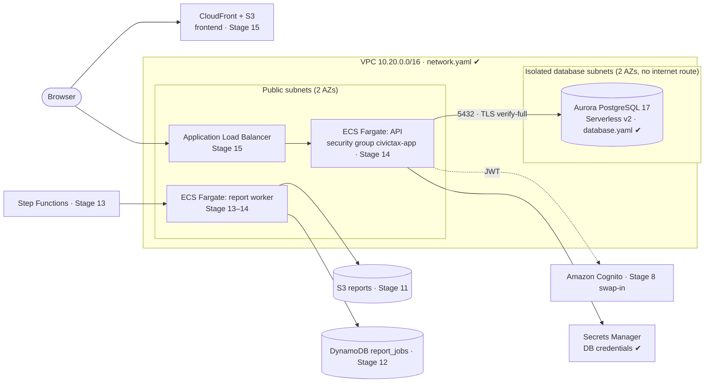

# AWS Architecture

Region **ca-central-1**. Infrastructure is CloudFormation in [`/infra`](../infra); deploy steps are in
[deployment.md](deployment.md). Built stage by stage; the diagram marks what exists as templates today.

## Network and database (Stage 10)
- **Isolation:** the database subnets' route table has only the in-VPC route. The cluster is `PubliclyAccessible: false`.
- **Who can reach the database:** only resources wearing the `civictax-app` security group, on port 5432.
  The database security group has no outbound rules.
- **Credentials:** `ManageMasterUserPassword` makes RDS generate the password and store it in Secrets Manager
  (KMS-encrypted). It never appears in a template, a parameter, the repo, or a terminal.
- **In transit:** `rds.force_ssl=1` rejects plain connections; the backend uses `sslmode=verify-full` with Amazon's
  RDS CA bundle (baked into the image), so it also refuses an impostor server.
- **At rest:** storage encryption with the AWS-managed key (customer-managed KMS key in Stage 16).
- **Schema:** identical to local. Flyway migrates on application start; local PostgreSQL 17 and Aurora PostgreSQL 17
  run the same SQL.

## Deliberate simplifications (demo cost) and their upgrade path
| Simplification | Production upgrade |
|---|---|
| No NAT gateway: Fargate tasks will run in public subnets with a public IP, protected by security groups | Private app subnets + NAT gateway or VPC endpoints (ECR, Secrets Manager, CloudWatch, S3) |
| One Aurora instance, 0–1 ACU, auto-pause | Second instance in another AZ (automatic failover), higher minimum capacity, no pause |
| Application connects as the master user (it needs DDL for Flyway) | Separate least-privilege runtime user; migrations run by a dedicated task/role |
| `DeletionProtection` off by default | On, plus longer backup retention |
