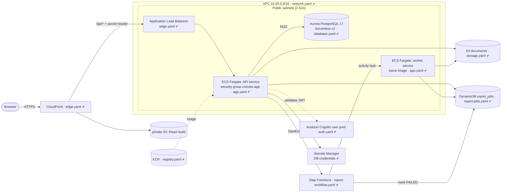

# AWS Architecture

Region **ca-central-1**. Infrastructure is CloudFormation in [`/infra`](../infra); deploy steps are in
[deployment.md](deployment.md). Built stage by stage; the diagram marks what exists as templates today.

## Network and database (Stage 10)
- **Placement:** the database shares the two public subnets with the application. The cluster is
  `PubliclyAccessible: false`, so it has no public address. The isolated-subnet and verified-TLS variant is kept on
  the `networking` branch.
- **Who can reach the database:** only resources wearing the `civictax-app` security group, on port 5432.
  The database security group has no outbound rules.
- **Credentials:** `ManageMasterUserPassword` makes RDS generate the password and store it in Secrets Manager
  (KMS-encrypted). It never appears in a template, a parameter, the repo, or a terminal.
- **In transit:** not enforced. The PostgreSQL driver's default (`sslmode=prefer`) uses TLS when the server offers
  it, but does not check the server's certificate.
- **At rest:** encrypted with the customer-managed KMS key from `security.yaml`, including backups and snapshots.
- **Schema:** identical to local. Flyway migrates on application start; local PostgreSQL 17 and Aurora PostgreSQL 17
  run the same SQL.

## Document storage (Stage 11)
- **Private by construction:** Block Public Access (all four), ACLs disabled, TLS-only bucket policy. There are no
  public objects and no presigned URLs: clients download through `GET /api/tax-bills/{id}/document`, so the same role
  and data-ownership rules as every other endpoint apply, and responses are `Cache-Control: no-store`.
- **Least privilege:** the application may only get and put objects under `tax-bills/` and `reports/`.
- **Encryption:** the bucket default is the customer-managed KMS key and uploads cannot ask for less; versioning on.
- **Metadata** (key, size, generated time) lives in PostgreSQL on `tax_bills`; keys contain no personal data.
- **Local:** the `adobe/s3mock` emulator in Docker Compose and in tests. (LocalStack now requires a paid/registered
  token, so each AWS service gets its own small emulator instead.)

## Report job state (Stage 12)
- **One DynamoDB table, `report_jobs`**, holding only the state of asynchronous report jobs. Properties, assessments,
  bills and payments stay relational in PostgreSQL. Job state suits DynamoDB: single-item lookups by id, no joins,
  bursty writes from workers, and automatic expiry.
- **Access patterns:** get by `jobId`; a user's jobs newest-first via the `byRequester` index (Query, never Scan).
- **Correctness under retries:** every status change is a conditional write that succeeds only from the expected
  current status, so two workers can't claim one job and a finished job can't be reopened.
- **Housekeeping and safety:** TTL removes jobs after 90 days; on-demand billing; point-in-time recovery; encrypted
  at rest with the customer-managed key. The IAM policy allows only GetItem, PutItem, UpdateItem and Query on the
  table and its index.

## Asynchronous reports (Stage 13)
- **Why asynchronous:** a report can take long and must not hold an HTTP request or an API thread; the API returns
  a job id in milliseconds and the client polls.
- **Why Step Functions owns the outcome:** timeout, retry and "mark FAILED" live in the state machine, not in
  worker code, so a worker that crashes mid-report still ends with a correctly failed job.
- **Activity task (worker polls) rather than ECS RunTask:** the whole flow runs unchanged against Amazon's local
  emulator, so it is tested end to end without an AWS account. The worker is the backend image with one flag, an
  ECS service in AWS; add copies to scale, Step Functions gives each task to exactly one.
- **Idempotent:** execution name = job id (a job can't be started twice); the worker can safely repeat a job
  (same S3 key, conditional DynamoDB writes).
- **Least privilege:** API may only start this state machine; the worker may only take this activity's tasks; the
  state machine may only update `report_jobs`. Reports are staff-only and served through the API like bill PDFs.

## Compute (Stage 14)
- **One image, two services.** ECR holds one immutable-tagged, scan-on-push backend image; the `api` and `worker`
  ECS services differ only in one environment flag and their task role.
- **Roles are split three ways:** the *execution role* (ECS pulls the image, writes logs, reads the DB secret), the
  *API task role* and the *worker task role* (what our code may do). The worker cannot start executions; the API
  cannot take tasks; neither can do anything outside its S3 prefixes and the one DynamoDB table.
- **Secrets** reach the container as environment variables injected by ECS from Secrets Manager at start.
- **Safe deploys:** the API starts a new task and waits for its health check before stopping the old one; a build
  that never becomes healthy is rolled back automatically (deployment circuit breaker).
- **Sign-in:** a Cognito user pool with no self sign-up (admins create accounts), 12-character passwords, optional
  TOTP MFA. The backend checks issuer, signature, expiry and audience, then reads the role from its own users
  table. `BOOTSTRAP_ADMIN_EMAIL` creates the first admin on an empty database, and only then.

## Edge (Stage 15)
- **One HTTPS origin for the browser:** CloudFront serves the frontend and proxies `/api/*`, so there is no CORS
  and the same Content-Security-Policy as local nginx applies (plus the Cognito domain).
- **The load balancer is not a second front door:** CloudFront's address list at the network layer and a generated
  secret header at the HTTP layer; a direct request gets 403. The tasks accept only the load balancer.
- **The frontend bucket is private**, readable only by this distribution (origin access control).
- **Sign-in** is Cognito's hosted page via authorization code + PKCE, implemented with the browser's Web Crypto
  (no SDK). The token lives in `sessionStorage`; there is no refresh, so a session lasts 60 minutes.

Security controls, scan results and open gaps are consolidated in [security.md](security.md).

## Deliberate simplifications (demo cost) and their upgrade path
| Simplification | Production upgrade |
|---|---|
| No NAT gateway: Fargate tasks will run in public subnets with a public IP, protected by security groups | Private app subnets + NAT gateway or VPC endpoints (ECR, Secrets Manager, CloudWatch, S3) |
| One Aurora instance, 0–1 ACU, auto-pause | Second instance in another AZ (automatic failover), higher minimum capacity, no pause |
| Application connects as the master user (it needs DDL for Flyway) | Separate least-privilege runtime user; migrations run by a dedicated task/role |
| HTTP between CloudFront and the load balancer (no certificate without a domain) | Own domain + ACM certificate + HTTPS listener, or an internal load balancer behind a CloudFront VPC origin |
| No refresh-token use: sign in again after 60 minutes | Silent refresh with the refresh token |
| No WAF | AWS WAF managed rules on the distribution |
| `DeletionProtection` off by default | On, plus longer backup retention |
| The report worker is an always-on ECS service polling for tasks | ECS `RunTask` per job (pay only while a report runs), or scale the service to zero on queue depth |
| Step Functions execution logging/tracing is off | CloudWatch Logs + X-Ray on the state machine |
| PDFs are generated inside the download request and proxied through the API | Generate in the async worker (Stage 13); presigned URLs or CloudFront signed URLs for large files |
