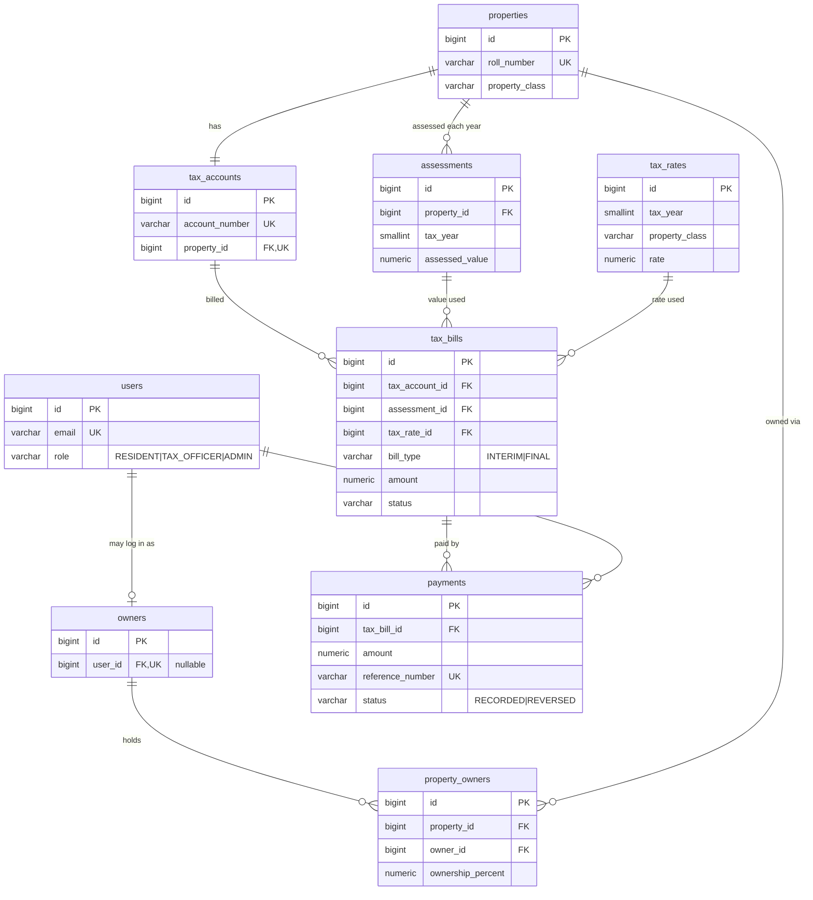

# Database Design

PostgreSQL 17 (local, Docker) → Aurora PostgreSQL (Stage 10). Schema is owned by Flyway:
[`V1__initial_schema.sql`](../backend/src/main/resources/db/migration/V1__initial_schema.sql). Hibernate only validates.

## ER diagram

## Relationships
| Kind | Tables | Enforced by |
|---|---|---|
| One-to-one (optional) | `users` ↔ `owners` — a resident login maps to at most one owner; owners need not have a login | `owners.user_id` nullable + `UNIQUE` |
| One-to-one | `properties` ↔ `tax_accounts` | `tax_accounts.property_id` `NOT NULL UNIQUE` |
| Many-to-many | `properties` ↔ `owners` via `property_owners` (carries `ownership_percent`) | `UNIQUE (property_id, owner_id)` |
| One-to-many | property → assessments (one per year) | `UNIQUE (property_id, tax_year)` |
| One-to-many | tax account → bills; bill → payments; user → payments recorded | FKs |
| Many-to-one (audit) | bill → the exact assessment and tax rate used for its amount | FKs |

Tax rate is looked up by `(tax_year, property_class)` — one rate per class per year.

## Key rules in the schema
- **Money**: `NUMERIC(14,2)`; rates `NUMERIC(10,8)` with `0 < rate < 1`. No floating point.
- **No cascades**: deleting a property/bill with history fails; financial records are never silently removed.
- **Outstanding balance is derived** (sum of live bills − sum of recorded payments), not stored, so it can't drift.
- **One live bill per account/year/type**: partial unique index `uq_tax_bills_live … WHERE status <> 'CANCELLED'` lets a cancelled bill be reissued.
- **Duplicate payments**: `payments.reference_number UNIQUE`. Mistakes are `REVERSED`, never deleted.
- **Enums** are `VARCHAR + CHECK` (readable, easy to extend by migration; no PG enum type friction with JPA).
- Lowercase-only emails (`CHECK (email = lower(email))`), Canadian postal code format, `due_date >= issue_date`, sane tax years.
- Postgres doesn't auto-index FKs: indexed where a unique constraint doesn't already lead with the column
  (`property_owners.owner_id`, `payments.tax_bill_id`).

## Document metadata (V2)
`V2__tax_bill_documents.sql` adds three nullable columns to `tax_bills` (no tenth table):

| Column | Meaning |
|---|---|
| `document_key` (unique) | S3 object key of the generated PDF, e.g. `tax-bills/2026/TA-00000001-2026-I-1.pdf`. No personal data in keys. Never returned by the API. |
| `document_size_bytes` | Size of the stored object |
| `document_generated_at` | When it was generated (exposed as `documentGeneratedAt`) |

A check constraint keeps the three all-null or all-set. The PDF is derived entirely from database rows, so S3 is
never the only copy: if the object is missing, the next download rebuilds it.

## Not in PostgreSQL
Asynchronous report-job state lives in the DynamoDB table `report_jobs` (see aws-architecture.md). It is bookkeeping,
not business data: nothing here references it and it can be lost without affecting any tax record.

## Deliberately not in the schema
- No `tax_adjustments` (out of scope by requirement). No ownership history dates (simulated ownership).
- Ownership percentages summing to 100 and payment ≤ remaining balance are service-layer rules (Stage 5) — they span rows.
- `updated_at` is maintained by JPA (Stage 3), not triggers.
